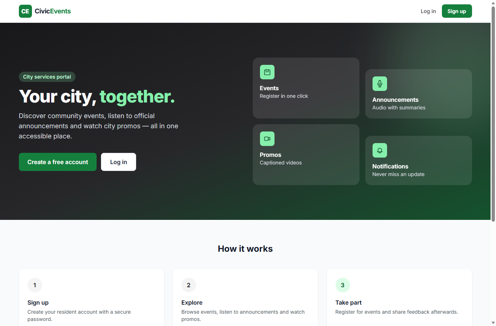
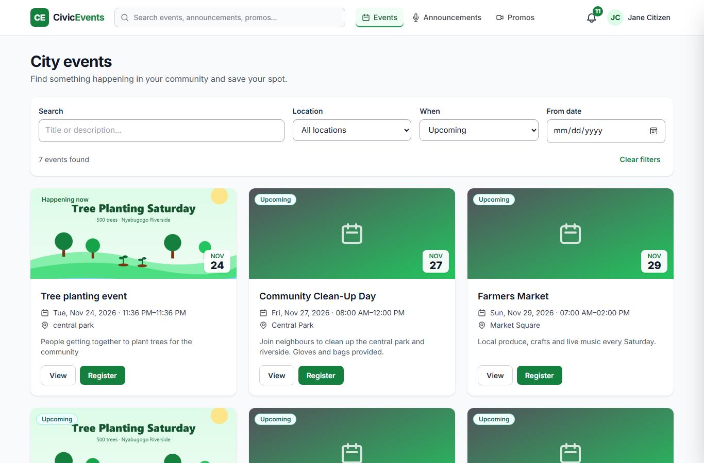
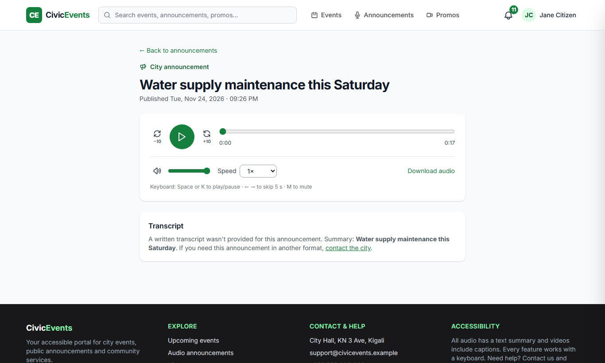
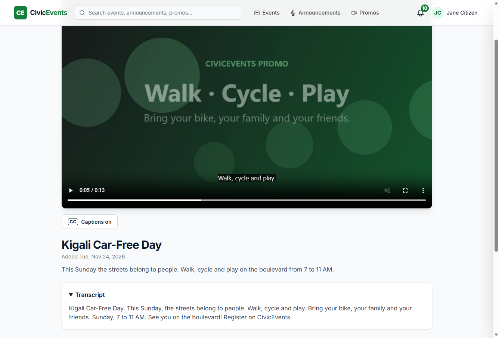
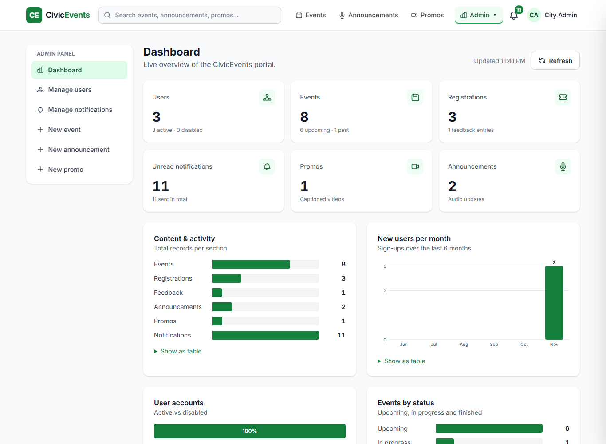
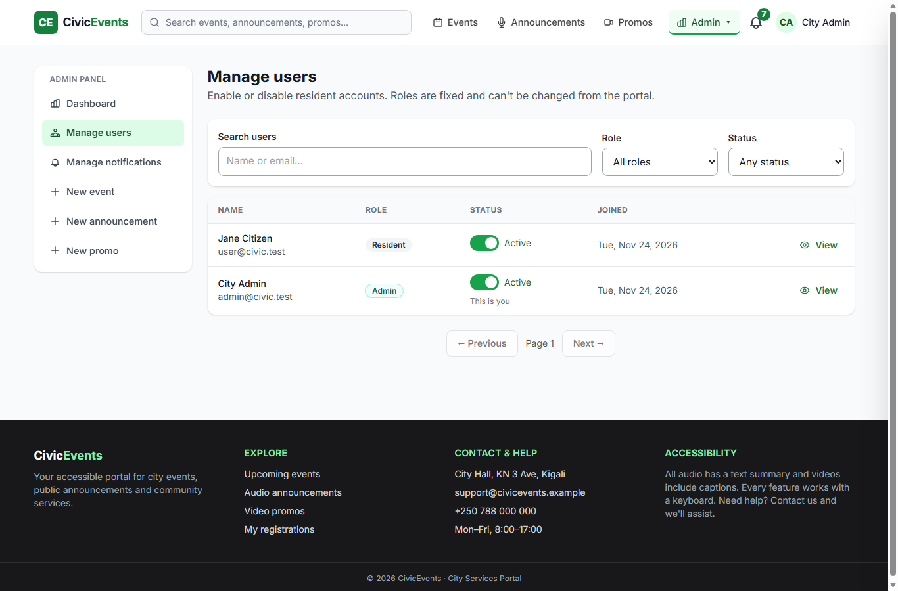
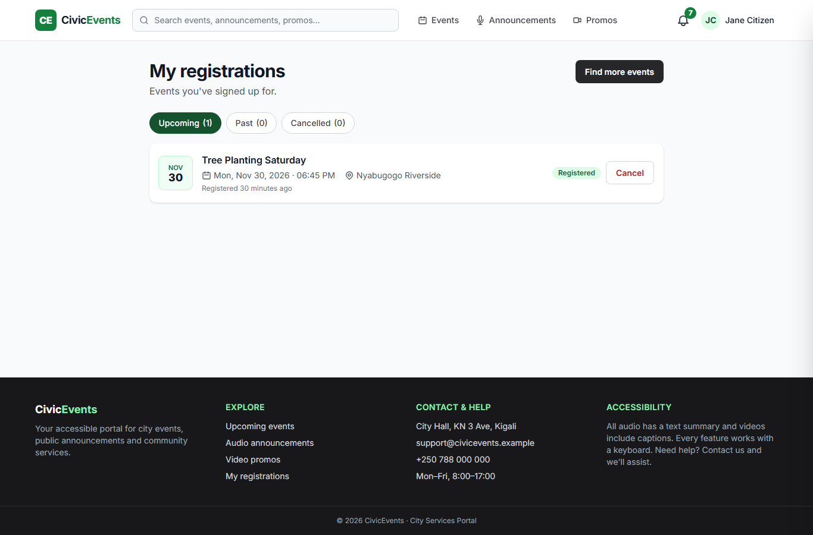
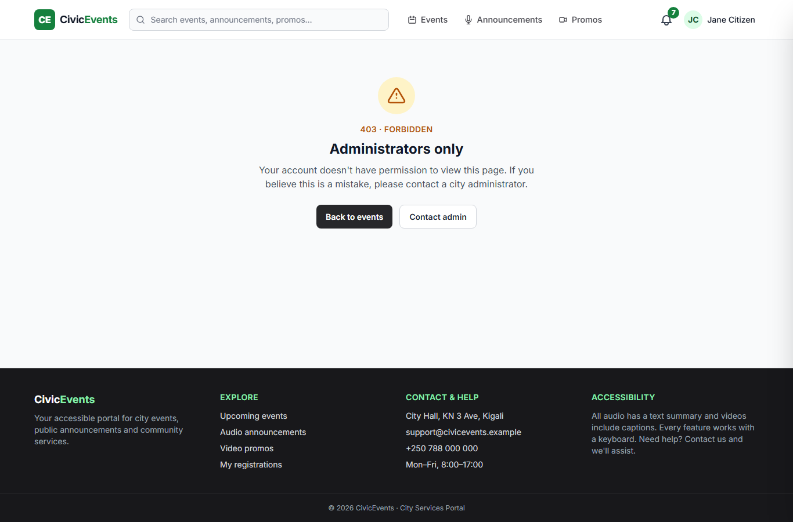

# CivicEvents+: Accessible City Events & Services Portal

CivicEvents+ is a city portal where residents can find and register for community events, listen to official **audio announcements**, watch **captioned video promos** and get **in-app notifications**. City administrators manage all of that content, plus user accounts, from an admin dashboard.

This repository is my submission for the *Advanced Frontend Development* summative. I built the **frontend** in [`frontend/`](frontend/) with **HTML, Tailwind CSS and jQuery only**. It runs against the provided **Node.js / Express API** in [`backend/`](backend/), which stores data in **PostgreSQL**.

| | |
|---|---|
| **Frontend** | HTML5, Tailwind CSS (CDN), jQuery 3.7. No build step, no framework. |
| **Backend** | Node.js + Express 5, JWT auth, Multer uploads (provided) |
| **Database** | PostgreSQL 15+ |
| **Demo video** | [Watch on YouTube](https://youtu.be/vUAG-Vf9gUg) |

---

## Contents

1. [Screenshots](#screenshots)
2. [Features](#features)
3. [Getting started](#getting-started)
4. [Demo accounts](#demo-accounts)
5. [Connecting the frontend to the backend](#connecting-the-frontend-to-the-backend)
6. [Viewing the database](#viewing-the-database)
7. [Project structure](#project-structure)
8. [Authentication & role-based access](#authentication--role-based-access)
9. [Accessibility & UX](#accessibility--ux)
10. [Backend limitations](#backend-limitations)
11. [Troubleshooting](#troubleshooting)

---

## Screenshots

| Home | Events (resident) |
|---|---|
|  |  |

| Audio announcement | Promo video with captions |
|---|---|
|  |  |

| Admin dashboard | Manage users (admin) |
|---|---|
|  |  |

| My registrations | Resident opening an admin page (403) |
|---|---|
|  |  |

---

## Features

### Everyone
- **Sign up** with full name, email, password and confirmation. A live **strength meter** enforces the policy: at least 8 characters, upper and lower case, a number and a symbol.
- **Log in** with a choice of session-only storage (`sessionStorage`) or "Keep me signed in" (`localStorage`).
- Sessions **expire automatically**: the user is signed out with a message when the JWT expires or the API returns 401.

### Residents (role `user`)
| Feature | What they can do |
|---|---|
| **Events** | Browse published events, search, filter by date range and location, paginate, see images and a Google Maps link |
| **Registration** | Register for an event, cancel, and see all their events on **My registrations** (upcoming / past / cancelled) |
| **Feedback** | Rate an event 1–5 with a comment, **once per event** (they can edit it later), and see the average rating |
| **Announcements** | Play audio in an accessible custom player (seek, ±10 s, volume, speed, keyboard shortcuts, download fallback) |
| **Promos** | Watch videos with **captions on by default**, a captions toggle and the full transcript |
| **Notifications** | Bell with unread count, slide-out drawer and an inbox page; opening one marks it read and links to the related event, announcement or promo |
| **Profile** | View their details and activity; edit their name and email (with a warning if the email is taken). Role and status can't be edited. |
| **Search** | One search across events, announcements and promos, with matches highlighted |

### Administrators (role `admin`)
| Feature | What they can do |
|---|---|
| **Dashboard** | Stat tiles and four charts (content totals, sign-ups per month, active vs disabled users, events by status). Each chart has a table view and the data refreshes every 60 s. |
| **Events** | Create and edit with an **image upload** (preview, type and size checks, progress bar), delete, see who registered and read all feedback |
| **Announcements** | Upload **audio**, publish/unpublish, edit and delete. Residents are notified automatically. |
| **Promos** | Upload **video** with caption text, publish/unpublish, edit and delete |
| **Users** | List, search and filter users, view a profile, **enable/disable** accounts. Roles can't be changed, and admins can't disable themselves. |
| **Notifications** | View all notifications by type and delete them one at a time (form) or several at once |

---

## Getting started

### Prerequisites
- **Node.js 18+** ([nodejs.org](https://nodejs.org/))
- **PostgreSQL 15+** running locally ([postgresql.org](https://www.postgresql.org/download/))
- A modern browser (Chrome, Edge or Firefox)

### 1. Clone the repository
```bash
git clone https://github.com/cashme8/advanced-frontend-dev-summative-civic-event-project.git
cd advanced-frontend-dev-summative-civic-event-project
```

### 2. Configure the backend
```bash
cd backend
npm install
cp .env.example .env
```
Then edit `backend/.env` with your PostgreSQL details:

| Variable | Example | Purpose |
|---|---|---|
| `DB_USER` | `postgres` | PostgreSQL user |
| `DB_PASS` | `your_password` | Password for that user |
| `DB_HOST` | `localhost` | Database host |
| `DB_PORT` | `5432` | Database port |
| `DB_NAME` | `civic-events-db` | Database name (created for you in the next step) |
| `JWT_SECRET` | any long random string | Signs login tokens |
| `PORT` | `4000` | Optional; the API port (default `4000`) |

### 3. Create the database and tables
```bash
npm run db:init      # creates the database if missing and runs migrations/001_create_tables.sql
```
This works without the `psql` command-line tool.

### 4. Start the API
```bash
npm run dev          # → "CivicEvents+ backend listening on port 4000" and "Connected to PostgreSQL"
```

### 5. Add the demo data (second terminal, API still running)
```bash
cd backend
npm run db:seed:demo # creates the demo admin and resident accounts and sample events
```

### 6. Start the frontend (third terminal)
```bash
cd frontend
npx serve .          # or: python -m http.server 5500
```
Open the URL it prints, for example **http://localhost:3000**.

---

## Demo accounts

| Role | Email | Password |
|---|---|---|
| **Admin** | `admin@civic.test` | `Admin@123` |
| **Resident** | `user@civic.test` | `User@1234` |

You can also sign up for a new resident account from the **Sign up** page.

---

## Connecting the frontend to the backend

Every backend URL lives in one file, [`frontend/js/config.js`](frontend/js/config.js):

```js
window.CivicConfig = {
    BASE_URL: 'http://localhost:4000',           // backend origin (also serves uploaded media)
    API_BASE_URL: 'http://localhost:4000/api',   // REST API root
    PAGE_SIZE: 6,                                // items per page on list views
    CACHE_TTL_MS: 2 * 60 * 1000,                 // list cache lifetime
    NOTIF_POLL_MS: 30 * 1000,                    // how often the bell refreshes
    UPLOAD_LIMITS: {                             // mirrors the backend's Multer limits
        image: { maxMB: 2, ext: ['jpg', 'jpeg', 'png', 'gif'] },
        audio: { maxMB: 5, ext: ['mp3', 'wav', 'm4a', 'ogg'] },
        video: { maxMB: 8, ext: ['mp4', 'mov', 'avi', 'mkv'] },
    },
};
```

If your API runs on another host or port, change `BASE_URL` and `API_BASE_URL`. The backend already enables CORS.

All requests go through one jQuery wrapper ([`frontend/js/core/api.js`](frontend/js/core/api.js)). It:
- adds `Authorization: Bearer <token>` to every protected request;
- sends JSON, or `multipart/form-data` for uploads (field names `image`, `audio`, `video`), with upload progress;
- turns API errors into readable messages. A **401** signs the user out and **403** shows "contact an administrator";
- caches the events, announcements and promos lists for 2 minutes and clears the cache after any change.

### API endpoints used

| Area | Endpoints |
|---|---|
| Auth | `POST /auth/signup`, `POST /auth/login` |
| Events | `GET /events`, `GET /events/:id`, `POST /events`, `PUT /events/:id`, `DELETE /events/:id` |
| Registrations | `POST /event-registrations/register`, `POST /event-registrations/cancel`, `GET /event-registrations/my-registrations`, `GET /event-registrations/event/:id/attendees` |
| Feedback | `POST /event-feedback`, `PUT /event-feedback/:id`, `GET /event-feedback/my-feedback`, `GET /event-feedback/event/:id` |
| Announcements | `GET`, `POST`, `PUT`, `DELETE /announcements(/:id)`, `PATCH /announcements/:id/publish\|unpublish` |
| Promos | `GET`, `POST`, `PUT`, `DELETE /promos(/:id)`, `PATCH /promos/:id/publish\|unpublish` |
| Notifications | `GET /notifications`, `GET /notifications/:id`, `DELETE /notifications/:id` |
| Users | `GET /users`, `GET /users/:id`, `PATCH /users/:id/enable\|disable`, `GET` + `PATCH /users/profile/me` |
| Dashboard | `GET /dashboard/admin`, `GET /dashboard/me` |

A Postman collection is included: [`backend/CivicEvents+ API.postman_collection.json`](backend/).

---

## Viewing the database

You don't need `psql` or pgAdmin. A helper script prints what is stored in PostgreSQL:

```bash
cd backend
npm run db:show                                        # connection info, every table and its row count, recent rows
npm run db:show -- users                               # a single table
npm run db:show -- "SELECT title, published FROM promos"   # your own read-only query
```

**Tables:** `users`, `events`, `event_registrations`, `event_feedback`, `announcements`, `promos`, `notifications`. The schema is in [`backend/migrations/001_create_tables.sql`](backend/migrations/001_create_tables.sql).

Uploaded files are saved in `backend/uploads/{events,announcements,promos}/` and served at `http://localhost:4000/uploads/...`. The database stores their URLs.

---

## Project structure

```
├── backend/                     provided Node/Express API (+ setup, seed and db:show scripts)
│   ├── migrations/              SQL schema
│   ├── scripts/                 setup-db.js, seed.js, db-show.js
│   └── src/                     routes, controllers, models, middlewares
├── docs/screenshots/            images used in this README
└── frontend/
    ├── index.html, login.html, signup.html
    ├── events.html, event.html, event-form.html
    ├── announcements.html, announcement.html, announcement-form.html
    ├── promos.html, promo.html, promo-form.html
    ├── notifications.html, admin-notifications.html
    ├── dashboard.html, users.html, profile.html, my-registrations.html, search.html
    ├── css/app.css              shared component styles (buttons, inputs, switches, focus rings)
    └── js/
        ├── config.js            API URLs and limits
        ├── tailwind.config.js   theme colours
        ├── core/                api.js · auth.js · ui.js · layout.js · notifications.js · components.js
        └── pages/               one script per page
```

There is a page-by-page breakdown, including which endpoints each page calls, in [`frontend/README.md`](frontend/README.md).

---

## Authentication & role-based access

**Token storage** ([`frontend/js/core/auth.js`](frontend/js/core/auth.js)):

| "Keep me signed in" | Storage | Trade-off |
|---|---|---|
| Unchecked (default) | `sessionStorage` | Cleared when the browser closes; safer on shared computers |
| Checked | `localStorage` | Survives restarts but is more exposed to XSS. Only the JWT and public user fields are stored. |

A global auth context holds `{ id, full_name, email, role }` and the token, and keeps open tabs in sync: signing out in one signs out the others.

**Where access is controlled.** Search the code for `ROLE GUARD` and `ADMIN-ONLY` to find each one.

1. **Page guard.** Each page declares its access on `<body>`, and `Auth.guard()` checks it before the page renders:
   ```html
   <body data-auth="required">                                <!-- must be logged in -->
   <body data-auth="required" data-role="admin">              <!-- admins only: residents see a 403 page -->
   ```
2. **Navigation.** The Admin menu, the Dashboard link and the admin sidebar render only when `Auth.isAdmin()` is true ([`layout.js`](frontend/js/core/layout.js)).
3. **Controls.** Create, edit, delete and publish buttons, "show unpublished" filters, the list of attendees and all feedback appear only for admins. Register and feedback forms appear only for residents ([`components.js`](frontend/js/core/components.js) and `js/pages/*`).
4. **Business rules.** Admins can enable or disable users but **cannot change roles**. Users can edit only their own name and email.

> These checks only shape what users see. The backend is the real security: `authenticate` + `authorize(['admin'])` middleware checks every request.

---

## Accessibility & UX

- Semantic landmarks, a **skip link**, labelled form fields, `aria-live` status regions, alt text and visible focus rings.
- Menus, the notification drawer and dialogs all work from the keyboard (focus trapping, Esc to close, arrow keys in menus).
- The audio player has labelled buttons and a seek slider that reads out the time. Videos have **captions on by default** (a WebVTT track built from the promo's caption text) and a transcript.
- **Skeleton loaders** while lists load, plus empty states, error states with **Try again**, toasts and confirmation dialogs.
- **Optimistic updates** (mark notification read, enable/disable user, cancel registration) that are undone if the request fails.
- Uploads are checked for type and size before sending, show a preview first and display a progress bar.
- Mobile-first, responsive layout. Promo thumbnails **lazy-load** when they scroll into view.
- High-contrast neutral and green theme with colour-blind-safe charts, each with a table view.

---

## Backend limitations

These come from the provided API. The frontend handles each one as noted:

| Limitation | How the frontend handles it |
|---|---|
| No endpoint to **create** notifications | They are created automatically when events, announcements and promos are created or published. Admins can view and delete them. |
| No **mark-as-read** endpoint | Read state is stored per user in `localStorage` |
| The events API ignores `published` | All events stay published. The event form warns the admin when this happens. |
| `PUT /announcements/:id` ignores a new audio file | Editing covers the title and published status; the form explains how to replace the audio |
| Registrations are unique per user and event | A cancelled place can't be re-booked; the UI explains this before you cancel |
| No **service requests** API (only a list of types in `utils/serviceTypes.js`) | Not implemented; there is no endpoint to call |

---

## Troubleshooting

| Problem | Fix |
|---|---|
| "Cannot reach the server" in the app | Start the API (`cd backend && npm run dev`) and check `frontend/js/config.js` |
| `PostgreSQL connection error` when starting the API | Make sure PostgreSQL is running and the `DB_*` values in `backend/.env` are correct |
| `EADDRINUSE: port 4000` | The API is already running in another terminal; use that one or close it |
| Login works but you're sent back to login straight away | Your token expired (tokens last 1 hour), so log in again. Check that `JWT_SECRET` hasn't changed while the API was running. |
| Images, audio or video don't load | Uploaded files live in `backend/uploads/`. Re-upload them if that folder was deleted. |
| Upload rejected | Limits: image 2 MB (jpg/png/gif), audio 5 MB (mp3/wav/m4a/ogg), video 8 MB (mp4/mov/avi/mkv) |

---

The backend API was provided by the course. The frontend was built by **Gislain Kabanda**.
